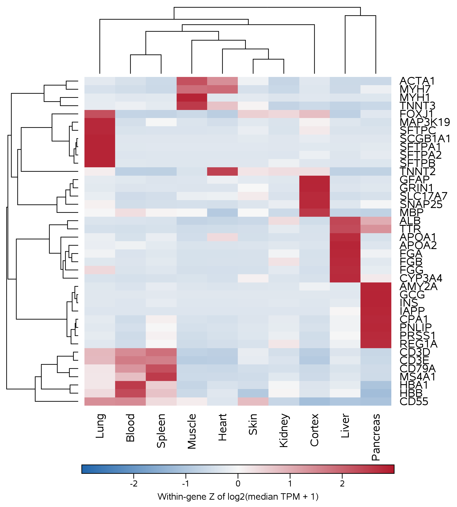
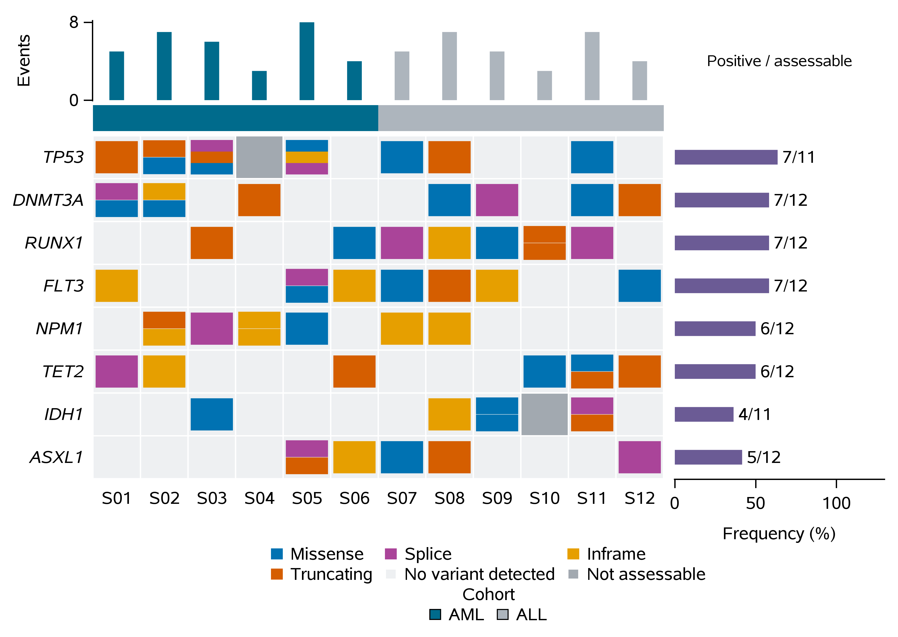
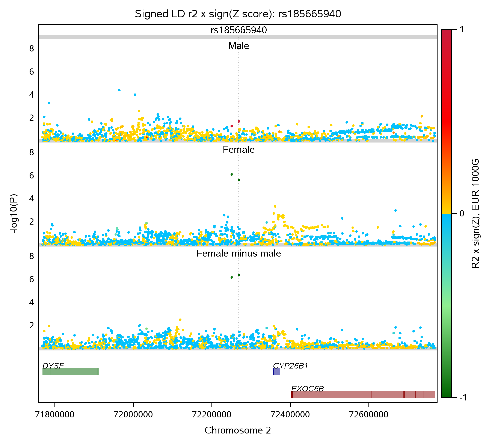

# MCP4SAS

Run SAS with AI agents through MCP, or from Perl/Bash: connect to **SAS OnDemand
for Academics (SAS ODA), local Linux SAS, and local Windows SAS** through SASPy.

[Quick start](#quick-start) · [Scientific showcases](#scientific-proof-of-concept-and-runnable-examples) · [Installation](#manual-installation) · [Local SAS home directories](docs/LOCAL_SAS_HOME.md)

For slow submissions or file transfers, see the
[performance debugging guide](docs/PERFORMANCE_DEBUGGING.md). It records the
measured fixes and provides a local source profiler for investigating similar
delays.

<p align="center">
  <a href="https://github.com/user-attachments/assets/c2406e84-fc6c-44d4-b320-62c7f757d4fb">
    
  </a>
</p>
<p align="center"><sub>Click the workflow figure to open the full-resolution version.</sub></p>

## Scientific proof of concept and runnable examples

Explore the [scientifically edited PoC and five illustrated use cases](docs/poc/README.md):
expression clustergrams, transcript tracks, mutation oncoprints, forest plots
and three-panel regional GWAS figures. The original Word documents, readable
Markdown, supplied SAS programs and small inputs are included.

- **Proof of concept:** [Read](docs/poc/proof-of-concept.md) · [Word](docs/poc/MCP4SAS_Proof_of_Concept_Scientifically_Edited.docx?raw=1).
- **Scientific appendix:** [Read](docs/poc/use-case-appendix.md) · [Word](docs/poc/MCP4SAS_Use_Case_Appendix_Scientifically_Edited.docx?raw=1).
- **Try it:** [Runnable examples and agent prompts](examples/poc/README.md).

<p align="center">
  <a href="docs/poc/use-case-appendix.md"></a>
  <a href="docs/poc/use-case-appendix.md"></a>
  <a href="docs/poc/use-case-appendix.md"></a>
</p>

After setup, run a first SAS example without an AI agent:

```bash
perl examples/poc/run_example.pl --case hello
```

MCP4SAS automates execution and file handling around reusable SAS expertise.
The PoC compares saved-program outputs; it does not establish general speed,
token-cost savings or biological validity. The oncoprint is explicitly synthetic.

## Supported SAS connections

| SAS target | SASPy profile | Connection and prerequisites |
| --- | --- | --- |
| SAS ODA | `oda` | SAS account, network access, Java, and SAS IOM encryption JARs obtained through SAS. |
| Local Linux SAS | `linuxlocal` | Installed, licensed Linux SAS; local STDIO through Linux Python and SASPy. |
| Local Windows SAS | `winlocal` | Installed SAS 9.4; local Java IOM through native Windows Python and SASPy. |
| Local Windows SAS, COM alternative | `winlocal_com` | Installed SAS 9.4; native Windows Python, SASPy and pywin32. |

The same `run_sas_codes_or_files_in_ODA.pl` runner works with all targets;
its historical filename does not limit it to ODA. Installers prepare MCP4SAS
and its dependencies; local SAS itself must already be installed and licensed.

## Quick start

Run the [platform installer](#manual-installation) first, then use these commands
from the MCP4SAS directory. Choose one target below in a fresh shell. The
connection check submits `proc setinit;run;` before you run an analysis.
An explicitly selected profile never silently falls back to another target.

### SAS ODA

Use the installer's Python/SASPy environment and your privately configured ODA
account. The connection check offers credential setup when needed.

```bash
export SASPY_CFGNAME=oda
export SAS_ODA_AUTOLOAD_MACROS=0
perl run_sas_codes_or_files_in_ODA.pl --check-saspy-connection-only
perl run_sas_codes_or_files_in_ODA.pl \
  --code 'proc print data=sashelp.class(obs=5); run;' \
  --output-prefix SAS_Output_RandID_oda_demo --run-timeout-seconds 120
```

See [First SAS ODA Login](#first-sas-oda-login) for account setup. Macro autoload
is disabled in these SASHELP examples; enable it when using an online collection.

### Local Linux SAS

Use Linux Python with SASPy installed and replace the SAS executable path.
The supplied profile connects through local STDIO.

```bash
export PIPELINE_PYTHON_BIN="$PWD/.venv-pipeline/bin/python"
export SASPY_CFGFILE="$PWD/install/sascfg_linux_local.py"
export SASPY_CFGNAME=linuxlocal
export SASPY_LOCAL_SAS_PATH='/path/to/your/SASFoundation/9.4/sas'
export SAS_ODA_AUTOLOAD_MACROS=0
perl run_sas_codes_or_files_in_ODA.pl --check-saspy-connection-only
perl run_sas_codes_or_files_in_ODA.pl \
  --code 'libname saved "~"; data saved.class; set sashelp.class(obs=5); run; proc print data=saved.class; run;' \
  --dir4local_sas_home "$PWD/local_sas_home" \
  --output-prefix SAS_Output_RandID_linux_demo --run-timeout-seconds 120
```

Set `PIPELINE_PYTHON_BIN` to another Linux Python if needed, and set
`SASPY_LOCAL_SAS_ENCODING` to match your SAS installation.

### Local Windows SAS from Cygwin

This example uses the supplied local COM profile. Native Windows Python needs
SASPy and pywin32 installed. Replace the Python path if your installation differs.

```bash
export PIPELINE_PYTHON_BIN="$(cygpath -m "$USERPROFILE/anaconda3/python.exe")"
export SASPY_CFGFILE="$(cygpath -m "$PWD/install/sascfg_windows_local_com.py")"
export SASPY_CFGNAME=winlocal_com
export SAS_ODA_AUTOLOAD_MACROS=0
# If needed, install dependencies into this native Windows Python first:
# "$PIPELINE_PYTHON_BIN" -m pip install saspy pywin32
perl run_sas_codes_or_files_in_ODA.pl --check-saspy-connection-only
perl run_sas_codes_or_files_in_ODA.pl \
  --code 'libname saved "~"; data saved.class; set sashelp.class(obs=5); run; proc print data=saved.class; run;' \
  --dir4local_sas_home ./local_sas_home \
  --output-prefix SAS_Output_RandID_windows_demo --run-timeout-seconds 120
```

For Java IOM and persistent Windows sessions, select `winlocal` with your
working local-only SASPy configuration. The shipped
`install/sascfg_personal.template.py` includes that profile. See
[Windows IOM/SSPI setup](docs/WINDOWS_LOCAL_IOM_SSPI.md) and
[target configuration](#configure-saspy-target).

### Files, saved data and persistent sessions

For local Linux/Windows SAS, `--dir4local_sas_home DIR` maps `~` to DIR for file
actions and quoted SAS paths. Its default is the HTML output directory. The
local examples above save `class.sas7bdat` under `local_sas_home` and print its
first five observations to HTML. With your selected local profile:

```bash
perl run_sas_codes_or_files_in_ODA.pl --dir4local_sas_home ./local_sas_home \
  --dir4listing '~'
perl run_sas_codes_or_files_in_ODA.pl --dir4local_sas_home ./local_sas_home \
  --upload-file example.csv
perl run_sas_codes_or_files_in_ODA.pl --dir4local_sas_home ./local_sas_home \
  --download-file '~/example.csv' --download-local-path ./example.downloaded.csv
```

Supply your own `example.csv`. For ODA, Linux STDIO or Windows `winlocal` IOM,
reuse WORK data by supplying the same session ID on both submissions:

```bash
perl run_sas_codes_or_files_in_ODA.pl \
  --code 'data a; set sashelp.class(obs=5); run;' \
  --persistent --session-id demo --run-timeout-seconds 120
perl run_sas_codes_or_files_in_ODA.pl \
  --code 'proc print data=work.a; run;' \
  --persistent --session-id demo --run-timeout-seconds 120
```

Keep the same explicit `--dir4local_sas_home` across local runs when output
prefixes differ and you need the same saved-file location. WORK stays in the
SAS session independently of this setting. The runner prints the HTML and SAS
log paths; a DATA-only program may produce a log without HTML. See
[local SAS home examples](docs/LOCAL_SAS_HOME.md) for details and file deletion.

Windows IOM execution, persistent WORK reuse and local file operations were
tested with SAS 9.4. Windows COM one-shot execution was also tested. Linux STDIO
profile selection and error handling passed offline tests; live Linux SAS
execution remains unverified because no local Linux SAS was available.
Installation CI checks dependencies and synthetic examples without a SAS
license or ODA login.

For MCP clients, keep the same Python and SASPy configuration environment and
start the server:

```bash
perl server.pl daemon -m production -l http://127.0.0.1:8080
```

Connect your MCP client to `http://127.0.0.1:8080/mcp`. For local file operations
through the server, set `SAS_LOCAL_HOME_DIR` to your chosen absolute local SAS
directory in the server environment.
On Linux use the absolute Linux path; with Cygwin and native Windows Python,
use `cygpath -am ./local_sas_home` to obtain its Windows path.

## Included tools

- `server.pl`: an HTTP MCP server exposing SASPy-backed SAS tools.
- `run_sas_codes_or_files_in_ODA.pl`: a command-line SASPy runner. The file
  name keeps historical ODA wording for compatibility.
- `RunLocalSASDirectly.sh`: an optional direct local SAS batch helper for
  running Linux SAS or Windows `sas.exe` without SASPy.
- `RunWindowsSAS.sh`: a compatibility wrapper around `RunLocalSASDirectly.sh`.
- `MCPDeps/SAS_ODA_Runner.pm`: the Perl/Python bridge around SASPy.
- `MCPDeps/sas_oda_session_server.py`: a persistent local SASPy session
  server for faster repeated SAS ODA calls.
- `MCPDeps/test_sas_oda_debug_macro_guard.pl`: regression test for the SAS
  32-character macro-name limit and bootstrap/session-server compatibility.
- `MCPDeps/test_sas_oda_connection_lifecycle.pl`: regression test for clear
  one-shot SASPy connection shutdown diagnostics.
- `MCPDeps/importallmacros_ue.sas`: helper for loading SAS macros from
  the SAS ODA `~/Macros` directory.
- `sas-oda-scientific-debugging/SKILL.md`: reusable evidence ladder and macro
  bootstrap rules for debugging SAS ODA scientific workflows.
- `docs/VALIDATION_TASKS.md`: ordered offline and live validation tasks with
  safety gates and acceptance evidence.
- `tests/new_validation_tasks_001_100.pl`: independent adversarial batch for
  include parsing, diagnostics, advisories, and scratch ownership safety.
- `tests/covid19_gwas_validation_tasks_001_500.pl`: 500 source-provenanced
  parser and dependency tasks derived from the macros and demos in
  `chengzhongshan/COVID19_GWAS_Analyzer` at the commit recorded in
  `tests/covid19_gwas_validation_corpus.json`.
- `tools/build_covid19_validation_corpus.pl`: reproducibly rebuilds that
  pinned validation manifest from a local COVID19_GWAS_Analyzer checkout.
- `tools/profile_sas_source.pl`: measures local source inspection and hashes
  its results without opening a SAS connection.

## Easiest setup: VS Code extension for Copilot and Codex

Download [mcp4sas-0.1.2.vsix](https://github.com/chengzhongshan/MCP4SAS/releases/download/vscode-v0.1.2/mcp4sas-0.1.2.vsix), then choose **Extensions → … → Install from VSIX…** in VS Code. Open your local SAS project and run **MCP4SAS: Quick Setup**. Select an existing MCP4SAS installation or let the extension install it, choose your project folder, then select **GitHub Copilot**, **OpenAI Codex**, or both.

On Windows, setup offers Cygwin **before** the MCP4SAS installer and helps locate/install Windows Java. macOS and Ubuntu/Debian use the existing platform installers. The extension registers Copilot through VS Code's MCP provider API and adds a backed-up, marked Codex configuration entry. It starts an owned loopback backend automatically; a separate server terminal is unnecessary.

Run **MCP4SAS: Check Connection**, then use the offered test prompt to verify an actual SAS result. SAS account registration and private SASPy authentication are still required; discovery alone does not test them. Local desktop folders are supported; remote SSH/WSL/containers need separate configuration. See the [extension guide and validation scope](integrations/vscode/README.md).

Runnable alternatives from a checkout: double-click `install/install_vscode_extension.cmd` on Windows, or run `bash install/install_vscode_extension.sh` on macOS/Linux. They download the published VSIX, check its release SHA-256, and invoke `code --install-extension`. You can always use the Extensions menu if the `code` command is unavailable. This is a GitHub-distributed extension, not a Marketplace listing.

### Automatic local dependencies in the editor

The extension starts MCP4SAS in the selected project folder and selects `SAS_ODA_AUTOLOAD_MACROS=0`. The existing runner can then upload recognized local file references and discovered macros automatically. For `%my_macro`, place `my_macro.sas` in the project's `Macros/` directory. Relative paths are resolved from that project folder. This differs from the default remote macro-collection bootstrap and does not resolve every dynamically constructed filename. Original SAS execution and macro implementations are unchanged.

## Manual installation

Choose your platform below. Each installer provisions the required local
dependencies and finishes with an installation smoke test.

### Ubuntu or Linux

```bash
git clone https://github.com/chengzhongshan/MCP4SAS.git
cd MCP4SAS
bash install/install_ubuntu.sh
```

If system packages are already installed, skip `apt`:

```bash
MCP4SAS_SKIP_APT=1 bash install/install_ubuntu.sh
```

### macOS

Install Xcode Command Line Tools when prompted, then run:

```bash
git clone https://github.com/chengzhongshan/MCP4SAS.git
cd MCP4SAS
bash install/install_macos.sh
```

The macOS installer uses Homebrew for Perl/Python/Java support.

### Windows with Cygwin

Open a Cygwin terminal, then run:

```bash
git clone https://github.com/chengzhongshan/MCP4SAS.git
cd MCP4SAS
bash install/install_cygwin.sh
```

If you already installed the required Cygwin packages, skip the package update:

```bash
MCP4SAS_SKIP_CYGWIN_SETUP=1 bash install/install_cygwin.sh
```

### Conda

This is useful on Linux, macOS, WSL, or a Unix-like shell with Conda available:

```bash
git clone https://github.com/chengzhongshan/MCP4SAS.git
cd MCP4SAS
bash install/install_conda.sh
```

By default this creates a Conda environment named `mcp4sas`. To choose another
name:

```bash
MCP4SAS_CONDA_ENV=my_sas_env bash install/install_conda.sh
```

Every installer finishes by running the local smoke check. You can repeat it
without reinstalling dependencies:

```bash
bash install/check_mcp4sas_install.sh
```

The GitHub Installation workflow runs fresh Ubuntu, Apple Silicon macOS, Intel
macOS, Windows/Cygwin, and Conda installations on every pull request and push
to `main`.

## Requirements

- A SAS OnDemand for Academics account, a local SAS installation, or a licensed
  remote SAS IOM server.
- Perl 5.
- Python 3.8 or newer.
- Java Runtime Environment, required by SASPy IOM.
- Network access to SAS ODA when using the `oda` config.

The install scripts create a repo-local Python virtual environment named
`.venv-pipeline` and install Perl modules under `local/perl5`.

## Configure SASPy Target

MCP4SAS uses SASPy configuration names to choose the SAS target. ODA remains the
default. Local SAS users should select a local config explicitly.

Create a repo-local SASPy config template:

```bash
bash install/install_saspy_config.sh
```

If you already have `~/sascfg_personal.py` but want MCP4SAS to use the repo
template with ODA and local SAS examples, force a repo-local copy:

```bash
MCP4SAS_OVERWRITE_SASPY_CONFIG=1 bash install/install_saspy_config.sh
```

The full installer writes the default configuration into the isolated SASPy
package so commands launched outside the repository use the same settings. A
repo-local copy is also created for inspection and customization. To use a
different file, pass it explicitly:

```bash
./run_sas_codes_or_files_in_ODA.pl \
  --saspy-cfgfile ~/sascfg_personal.py \
  --saspy-cfgname oda \
  --check-sas-oda-login-only
```

Select a target with `SASPY_CFGNAME` or `--saspy-cfgname`.
When a target is explicitly selected, MCP4SAS does not silently fall back to
another SASPy profile if that connection fails.

SAS ODA:

```bash
SASPY_CFGNAME=oda ./run_sas_codes_or_files_in_ODA.pl --check-sas-oda-login-only
```

Local Linux SAS:

```bash
SASPY_CFGNAME=linuxlocal \
MCP4SAS_LOCAL_SAS_PATH=/opt/sasinside/SASHome/SASFoundation/9.4/bin/sas_u8 \
./run_sas_codes_or_files_in_ODA.pl --check-saspy-connection-only
```

`MCP4SAS_LOCAL_SAS_PATH` must point to the local `sas` or `sas_u8` executable.
Linux STDIO configuration is provided and tested offline. A live Linux SAS
connection has not been verified because no local Linux SAS was available.

Local Windows SAS through SASPy IOM:

```bash
export PIPELINE_PYTHON_BIN="$(cygpath -m "$USERPROFILE/anaconda3/python.exe")"
export SASPY_CFGFILE="$(cygpath -m "$USERPROFILE/sascfg_winlocal_sasjava.py")"
export SASPY_CFGNAME=winlocal
export SAS_ODA_AUTOLOAD_MACROS=0
perl run_sas_codes_or_files_in_ODA.pl --check-saspy-connection-only

perl run_sas_codes_or_files_in_ODA.pl \
  --code 'proc print data=sashelp.class(obs=5); run;' \
  --output-prefix "SAS_Output_RandID_winlocal_$(date +%Y%m%d_%H%M%S)"
```

The Windows profile uses SAS's bundled 64-bit Java when it is present and adds
the SAS `core/sasext` directory to the Python process `PATH` for SSPI. Override
the DLL directory with `SASPY_SSPI_PATH` if SAS is installed elsewhere. On
Cygwin, explicitly select native Windows Python as above and adjust the Python
and configuration paths for your installation. The runner converts helper paths
for that interpreter. To override the template's local Java runtime, use a
Windows path, for example:

```bash
SASPY_JAVA_WIN='C:/Program Files/Java/jdk-11/bin/java.exe' \
perl run_sas_codes_or_files_in_ODA.pl --saspy-cfgfile sascfg_personal.py \
  --check-saspy-connection-only
```

See [local IOM/SSPI troubleshooting](docs/WINDOWS_LOCAL_IOM_SSPI.md) for the
verified reverse-loopback SPN repair and the optional local COM profile.

Remote licensed IOM servers can use `iomlinux` or `iomwin` with
`SASPY_IOMHOST`, `SASPY_IOMPORT`, and `SASPY_IOM_AUTHKEY`.

## Direct Local SAS Without SASPy

MCP4SAS also exposes `run_local_sas_without_saspy` for users who want to run an
installed local SAS executable directly. This tool does not use SASPy. It starts
a fresh Linux SAS or Windows `sas.exe` batch process for each call through
`RunLocalSASDirectly.sh` and then polls the operating-system PID.

For Linux SAS:

```bash
export MCP4SAS_LOCAL_SAS_EXE='/opt/sasinside/SASHome/SASFoundation/9.4/bin/sas_u8'
```

For Windows SAS from Cygwin/MSYS:

```bash
export MCP4SAS_WINDOWS_SAS_EXE='/cygdrive/c/Program Files/SASHome/SASFoundation/9.4/sas.exe'
```

Then start MCP4SAS and call `run_local_sas_without_saspy` from the agent:

```bash
perl server.pl daemon -m production -l http://127.0.0.1:8080
```

You can also pass `local_sas_exe` and optionally `local_sas_platform` (`linux`
or `windows`) as MCP tool arguments.

Important limitation: this direct batch tool is not persistent. Each tool call
launches a new SAS process, so `WORK` data sets, macro variables, librefs,
options, and loaded macros do not carry over to the next call. Polling reports the helper exit code and flags nonzero exits as MCP errors.
Logs and HTML are retained after worker scratch cleanup.

If you need persistent local SAS state, use the SASPy-backed runner instead:

```bash
SASPY_CFGNAME=linuxlocal ./run_sas_codes_or_files_in_ODA.pl --check-saspy-connection-only
SASPY_CFGNAME=winlocal   ./run_sas_codes_or_files_in_ODA.pl --check-saspy-connection-only
```

Feasibility note: persistent local SAS without SASPy is possible only by adding
a resident session manager that starts SAS once, sends multiple code blocks to
the same process, marks log/listing boundaries, handles interrupts and
timeouts, and shuts the process down cleanly. That is a larger design than the
current batch helper. For now, SASPy `linuxlocal`, `winlocal`, or another SASPy
configuration is the recommended persistent-session path.

## Use With Vagrant

From a machine with Vagrant and VirtualBox installed:

```bash
git clone https://github.com/chengzhongshan/MCP4SAS.git
cd MCP4SAS
vagrant up
vagrant ssh
cd /vagrant
bash install/install_ubuntu.sh
```

This gives Windows and macOS users a clean Ubuntu runtime without modifying the
host system.

## First SAS ODA Login

SAS ODA requires the SAS IOM encryption JARs used by SASPy:

```text
sas.rutil.jar
sas.rutil.nls.jar
sastpj.rutil.jar
```

SASPy documents this requirement for SAS ODA/SAS 9.4M7 here:
https://sassoftware.github.io/saspy/configuration.html#sas-iom-client-encryption-jars

MCP4SAS does not distribute SAS or SASPy JAR files. The installer gets
SASPy's Java bridge and its other package assets from the `saspy` Python package.
Obtain the three SAS IOM encryption JARs from the
[official SAS download page](https://support.sas.com/downloads/package.htm?pid=2494) using your SAS Profile and
extract them into a local directory. That directory must directly contain all
three files. The installer never accesses your SAS account or handles your SAS
credentials.

Provide the directory when installing or updating the SASPy IOM configuration:

```bash
export MCP4SAS_SASPY_IOM_DIR="$HOME/sas-iom-encryption-jars"
bash install/install_ubuntu.sh
```

For an existing installation, run:

```bash
MCP4SAS_SASPY_IOM_DIR="$HOME/sas-iom-encryption-jars" \
bash install/install_saspy_iom_jars.sh
```

If the JARs are already available from the installed SASPy package, the path is
optional. Without them, the installer completes but SAS ODA connections may
fail until the SAS-provided JARs are configured.

Interactive credential setup:

```bash
./run_sas_codes_or_files_in_ODA.pl --prompt-sas-oda-auth --check-sas-oda-login-only
```

Noninteractive credential setup:

```bash
./run_sas_codes_or_files_in_ODA.pl \
  --sas-oda-account you@example.com \
  --sas-oda-password 'your-password' \
  --check-sas-oda-login-only
```

Credentials are saved in the SASPy authinfo file after validation with
`proc setinit;run;`.

## Run SAS Code From The Command Line

Simple code:

```bash
OPEN_RESULT=0 ./run_sas_codes_or_files_in_ODA.pl \
  --code "proc print data=sashelp.class(obs=5); run;" \
  --persistent \
  --session-id demo
```

Run a `.sas` file:

```bash
OPEN_RESULT=0 ./run_sas_codes_or_files_in_ODA.pl \
  --file my_program.sas \
  --persistent \
  --session-id demo
```

Run code from standard input:

```bash
printf '%s\n' \
  'data a;' \
  'input a @@;' \
  'datalines;' \
  '10 20' \
  ';' \
  'run;' \
  'proc print data=a;' \
  'run;' |
OPEN_RESULT=0 ./run_sas_codes_or_files_in_ODA.pl \
  --code - \
  --persistent \
  --session-id demo
```

Long SAS job:

```bash
OPEN_RESULT=0 ./run_sas_codes_or_files_in_ODA.pl \
  --file long_job.sas \
  --run-timeout-seconds 7200 \
  --persistent \
  --session-id long_job
```

Disable the wrapper timeout:

```bash
OPEN_RESULT=0 ./run_sas_codes_or_files_in_ODA.pl \
  --file very_long_job.sas \
  --no-run-timeout \
  --persistent \
  --session-id long_job
```

Stop wedged local SASPy/SAS ODA helper processes:

```bash
./run_sas_codes_or_files_in_ODA.pl --kill-saspy-sessions
```

## Upload, Download, Delete, And List ODA Files

When two or more files are uploaded or downloaded, the runner now uses one
validated ZIP transfer by default. Pass `--no-archive-transfers` only when
diagnosing compatibility problems. Existing uploads are reused when their
remote size and timestamp match; pass `--no-skip-upload-if-same` to force a
replacement.

One-shot actions now print a structured connection lifecycle message before
calling SASPy `endsas()`. It identifies the subprocess, completed action,
result, closure reason, and expected next step. This distinguishes an expected
one-shot connection shutdown from an unexpected SAS ODA transport failure.
Persistent sessions remain open until they are stopped, expire, or encounter a
transport failure.

Upload:

```bash
./run_sas_codes_or_files_in_ODA.pl \
  --upload-file local.csv \
  --persistent \
  --session-id demo
```

List remote files:

```bash
./run_sas_codes_or_files_in_ODA.pl \
  --dir4listing '~/Macros' \
  --persistent \
  --session-id demo
```

File info:

```bash
./run_sas_codes_or_files_in_ODA.pl \
  --file-info '~/myfile.csv' \
  --persistent \
  --session-id demo
```

Download:

```bash
./run_sas_codes_or_files_in_ODA.pl \
  --download-file '~/result.csv' \
  --download-local-path ./result.csv \
  --persistent \
  --session-id demo
```

Delete:

```bash
./run_sas_codes_or_files_in_ODA.pl \
  --delete-file '~/old_result.csv' \
  --persistent \
  --session-id demo
```

`--delete-file-rgx` matches both regular files and immediate-child
directories returned by the remote listing. Matching files are bulk-deleted;
matching directories and all of their contents are deleted recursively through
the same guarded `Del_Dir_Recursive` workflow described below. Explicit
`--delete-file` remains a file-only operation.

### Delete ODA directories by regular expression

Preview matching immediate child directories in SAS ODA home:

```bash
perl run_sas_codes_or_files_in_ODA.pl \
  --delete-dir '~' --delete-directory-rgx '^tmp_.*$' \
  --delete-directory-dry-run --persistent --session-id cleanup
```

Delete the matches, including their contents:

```bash
perl run_sas_codes_or_files_in_ODA.pl \
  --delete-dir '~' --delete-directory-rgx '^tmp_.*$' \
  --persistent --session-id cleanup
```

`--delete-dir` defaults to remote `~`; quote remote paths so Bash does not
expand them locally. Patterns use SAS PRX syntax and match directory
basenames, not full paths. Repeat `--delete-directory-rgx` to combine
patterns. Regular files are excluded even when their names match. Run
directory cleanup separately from `--code` or `--file`. Both CLI entry
points support these options.

The operation explicitly includes `~/Macros/Del_Dir_Recursive.sas` and calls
`%Del_Dir_Recursive(upper_dir,lower_dir)` with positional arguments. It
verifies that each selected directory and the macro's `_DELETE_` staging
path disappear. A preexisting `_DELETE_` or cleanup lock blocks deletion;
`Macros`, the staging/lock names and macro-unsafe path characters are
protected. The parent lock serializes MCP4SAS directory cleanup operations
under that parent. The original recursive macro determines how contents
are traversed. No macro file is uploaded or replaced by this operation.

MCP tool arguments for `run_sas_codes_or_files_in_ODA`:

```json
{
  "delete_directory_rgx": "^tmp_.*$",
  "delete_dir": "~",
  "delete_directory_dry_run": true,
  "persistent": "true",
  "session_id": "cleanup"
}
```

Set `delete_directory_dry_run` to `false` to delete. Regex arrays are also
accepted. Poll the returned PID using the existing MCP status workflow.
See [the real-example report](RealExamples4ImprovingMCP4SAS.md) for live
verification, including nonempty directories and the staging collision test.

## SAS Macro Loading

By default, if submitted SAS code calls non-built-in macros, MCP4SAS loads
macros from SAS ODA `~/Macros` through `importallmacros_ue.sas`.

Useful behavior:

- Targeted remote loading first checks exact-case `.sas` paths in both
  search folders. If neither exists, it scans the directories and compares
  filenames case-insensitively, including the extension, then includes the
  actual Linux filename. Ordinary macros search `~` before `~/Macros`;
  `Del_Dir_Recursive` retains its Macros-first preference. Multiple folded
  matches in the selected folder produce an ERROR and no candidate is
  included. Resolution messages remain visible with SAS `NONOTES` enabled.
  This handles case differences; it does not guess spelling mistakes or
  discover macros stored under unrelated filenames.
- `%Del_Dir_Recursive` explicitly loads its case-correct remote source from
  `~/Macros`, independently of the global bootstrap, so its supporting
  `recursiveDelete` macro is available. Lowercase invocations are supported.
- Reusing `--persistent --session-id <id>` avoids repeating expensive bootstrap
  work on every command.
- If the local `importallmacros_ue.sas` helper already matches the remote copy
  in SAS ODA `~` by size and timestamp, upload is skipped.
- If local macro files are newer than matching SAS ODA `~/Macros/*.sas` files,
  the local copy can be uploaded and included after the global macro bootstrap.

Useful environment variables:

```bash
SAS_ODA_AUTOLOAD_MACROS=1
SAS_ODA_MACRO_BOOTSTRAP_TIMEOUT_SECONDS=420
SAS_ODA_CLIENT_HEARTBEAT_SECONDS=20
```

The waiting heartbeat includes elapsed time, for example:

```text
Waiting for SAS ODA session server response while reading response header (elapsed=60s, timeout=3675s)...
```

## Run The MCP Server

```bash
perl server.pl daemon -m production -l http://127.0.0.1:8080
```

The MCP endpoint is:

```text
http://127.0.0.1:8080/mcp
```

Keep this terminal open while the AI agent is using MCP4SAS. For a persistent
background service on Linux, you can use `nohup`:

```bash
nohup perl server.pl daemon -m production -l http://127.0.0.1:8080 \
  > mcp4sas.server.log 2>&1 &
```

Stop the server by pressing `Ctrl-C` in the server terminal, or by killing the
background process:

```bash
pkill -f 'server.pl daemon.*127.0.0.1:8080'
```

Tools exposed:

- `run_sas_codes_or_files_in_ODA`
- `run_sas_codes_or_script_in_ODA`, compatibility alias
- `run_local_sas_without_saspy`, direct one-shot Linux/Windows SAS batch runner
  without SASPy or persistent session reuse
- `run_sas_codes_or_script_on_local_Windows`, compatibility alias for the direct
  local SAS tool

Example MCP tool arguments:

```json
{
  "sas_codes_or_file": "proc print data=sashelp.class(obs=5); run;",
  "persistent": "1",
  "session_id": "demo"
}
```

For long jobs, the first MCP call returns a PID. Poll later with:

```json
{
  "pid": 12345
}
```

Poll long-running SAS jobs no more than about every 30 seconds. MCP4SAS starts
SAS work in a background process so the AI agent does not need to hold one MCP
request open for the whole SAS runtime.

Each MCP job writes user-facing logs and HTML to a unique
`SAS_Output_MCP4SAS_*` results directory. Generated SAS input, worker stdout,
and other scratch files are removed automatically when the worker finishes.
If a worker is forcibly terminated before completing, its scratch directory
may remain for debugging.

## Minimal JSON-RPC Smoke Test

In one terminal:

```bash
perl server.pl daemon -m production -l http://127.0.0.1:8080
```

In another terminal:

```bash
curl -s http://127.0.0.1:8080/mcp \
  -H 'Content-Type: application/json' \
  -d '{"jsonrpc":"2.0","id":1,"method":"tools/list","params":{}}'
```

You should see the tools `run_sas_codes_or_files_in_ODA`,
`run_sas_codes_or_script_in_ODA`, `run_local_sas_without_saspy`, and
`run_sas_codes_or_script_on_local_Windows`.

## Configure AI Agents

MCP4SAS is an HTTP MCP server. Start `server.pl` first, then point your AI
agent's MCP configuration to:

```text
http://127.0.0.1:8080/mcp
```

Keep the server on `127.0.0.1` unless you know how to secure it. The tools can
run SAS code and perform SAS ODA file operations, so do not expose this endpoint
to an untrusted network.

### Codex

OpenAI Codex supports MCP servers in the CLI and IDE extension. Codex stores MCP
configuration in `config.toml`; by default this is `~/.codex/config.toml`, and a
trusted project can also use `.codex/config.toml`. See the official Codex MCP
documentation: https://developers.openai.com/codex/mcp

Recommended CLI setup:

```bash
codex mcp add mcp4sas --url http://127.0.0.1:8080/mcp
```

Manual `~/.codex/config.toml` setup:

```toml
[mcp_servers.mcp4sas]
url = "http://127.0.0.1:8080/mcp"
tool_timeout_sec = 120
default_tools_approval_mode = "prompt"
enabled = true
```

Then start or restart Codex:

```bash
codex
```

Inside the Codex terminal UI, use:

```text
/mcp
```

to confirm that `mcp4sas` is available. In the Codex IDE extension, open MCP
settings or the shared `config.toml` and use the same server definition.

Example prompt for Codex:

```text
Use the MCP4SAS tool to run:
proc print data=sashelp.class(obs=5); run;
Use session_id demo and check the result when the job finishes.
```

### Gemini CLI

Gemini CLI uses a JSON settings file for MCP server configuration. Google
codelab material shows `.gemini/settings.json` as the project-level settings
file and uses `mcpServers` to define MCP tools; for an HTTP MCP server, the
Gemini example uses `httpUrl`. See:
https://codelabs.developers.google.com/cloud-gemini-cli-mcp-go

Create or edit `.gemini/settings.json` in your project, or edit the user-level
Gemini settings file if you want MCP4SAS available globally:

```json
{
  "mcpServers": {
    "mcp4sas": {
      "httpUrl": "http://127.0.0.1:8080/mcp"
    }
  }
}
```

Restart Gemini CLI after changing the settings:

```bash
gemini
```

Then ask Gemini to list or use the MCP4SAS tools. Example prompt:

```text
Use the mcp4sas MCP server to submit this SAS code to SAS ODA:
proc print data=sashelp.class(obs=5); run;
Use a persistent session named demo.
```

If your Gemini CLI build only supports command-based stdio MCP servers, use a
separate HTTP-to-stdio MCP proxy or upgrade Gemini CLI to a build that supports
HTTP MCP configuration.

### Ollama And Other Local LLM Clients

Ollama itself is a local model runtime, not an MCP client. To use MCP4SAS with
an Ollama model, run Ollama behind an MCP-capable client or bridge. Examples of
this pattern include local agent shells, desktop chat clients, or gateway tools
that support MCP servers and can route tool calls to an Ollama-backed model.

General pattern:

```bash
ollama serve
ollama pull qwen2.5-coder:7b
perl server.pl daemon -m production -l http://127.0.0.1:8080
```

Then configure your MCP-aware Ollama client with:

```json
{
  "mcpServers": {
    "mcp4sas": {
      "url": "http://127.0.0.1:8080/mcp"
    }
  }
}
```

Some clients use `url`, some use `httpUrl`, and older clients only support
stdio-style MCP servers. For stdio-only clients, add an HTTP-to-stdio MCP proxy
between the client and `http://127.0.0.1:8080/mcp`, or use a client that
supports streamable HTTP MCP servers directly.

Good local-model prompts should be explicit because smaller local models may
not infer polling behavior:

```text
Use MCP4SAS to run this SAS code in SAS ODA:
proc means data=sashelp.class; var height weight; run;
If the first tool call returns a PID, wait and poll with that PID later.
Do not poll more often than every 30 seconds.
```

### Other MCP Clients

For any MCP client that supports streamable HTTP servers, use:

```text
name: mcp4sas
url:  http://127.0.0.1:8080/mcp
```

For clients that require stdio servers, use an HTTP-to-stdio MCP proxy or wrap
the MCP4SAS HTTP endpoint with the proxy recommended by that client. MCP4SAS
itself should continue running as the HTTP service shown above.

## Recommended Agent Workflow

1. Start MCP4SAS:

```bash
cd MCP4SAS
perl server.pl daemon -m production -l http://127.0.0.1:8080
```

2. In the AI agent, call `run_sas_codes_or_files_in_ODA` with SAS code or a
   local `.sas` file.
3. If the response contains a PID, wait at least 30 seconds before polling.
4. Poll with `{"pid": <PID>}` until the job completes.
5. Ask the agent to inspect the returned `output.html.info.txt` path if the SAS
   log contains errors or warnings.
6. Reuse `session_id` for related calls so WORK tables and loaded macros stay
   available.

For direct local Linux or Windows SAS without SASPy, call
`run_local_sas_without_saspy` instead. Do not expect persistent state between
calls; combine dependent SAS steps in one submitted program, or use
`saspy_cfgname=linuxlocal` or `saspy_cfgname=winlocal` with the SASPy-backed
tool.

## MCP Server Security Notes

- Bind to `127.0.0.1` for local use.
- Do not expose MCP4SAS on a public interface without authentication and network
  controls.
- Prefer interactive SAS ODA credential setup instead of pasting passwords into
  AI prompts.
- If you use `sas_oda_password` through an MCP call, treat the conversation and
  logs as sensitive.
- Review agent-generated SAS code before running it against sensitive data.

## Synchronize Local and Remote Copies

Run from your MCP4SAS checkout in Bash (Cygwin on Windows):

```bash
bash update_github_upload.sh --dry-run
bash update_github_upload.sh "Update SAS ODA helpers"
bash update_github_upload.sh --pull-only
```

The normal command fetches `origin/main`, commits eligible source and documentation
changes, merges remote updates, and pushes without force. Run it in each checkout
to synchronize that local copy with GitHub. `--pull-only` downloads and merges
updates without committing or pushing your edits. `--dry-run` previews against
the last fetched state without contacting GitHub or changing the real index.

Credentials, local dependencies, and SAS run artifacts are excluded from new
commits. New files must have a recognized source/documentation extension;
review the preview before publishing. Remote or branch overrides use
`REMOTE_NAME` and `BRANCH_NAME`; the current branch must match the target.
Git authentication and commit identity must already be configured.

Tracked edits that cannot be committed are temporarily stashed if merging requires
it. Conflicts stop before pushing, and saved edits remain recoverable in Git.
Follow the printed recovery instructions before rerunning.

## Troubleshooting

Standalone CLI calls automatically remove their owned intermediate directory
on exit while preserving final logs and results. Use `--keep-intermediate-files`
to retain scratch for debugging. Preview older retained scratch with
`perl cleanup_mcp4sas_intermediates.pl --directory .`; add `--apply` to remove
eligible marked directories. See the cleanup examples in the validation report.

For the complete Cygwin/Perl commands, reproduced failures, live results, and
resulting fixes, see [Real Examples for Improving MCP4SAS](RealExamples4ImprovingMCP4SAS.md).

The report also includes 30 additional generated SAS cases run through the
real MCP HTTP interface. Generate their SAS files without connecting to ODA
with `perl tests/run_live_new_examples_30.pl --generate-only`, or follow the
report's server and `--live` commands to execute them. Completed ODA polls
include `structuredContent.status`, `exit_code`, `log_path`, and a separate
warning/data-quality diagnostic summary. A warning or data-quality NOTE does
not change a successful job into a failure. Use SAS `options notes;` when
you want SAS to emit those NOTES.

A second independent batch generates cases 31-60: add `--batch 2` to the
generator or live command. Its catalog is maintained in
`tests/new_examples_31_60.pl`. The harness rejects source duplicates across
the two batches. Preflight now recognizes raw DATALINES/CARDS records,
including their four-semicolon variants, so apostrophes and comment tokens
in those records are accepted as data. Missing inline-data terminators and
malformed SAS after the data block are still reported.

Use `--batch 3` for thirty further examples numbered 61-90, maintained in
`tests/new_examples_61_90.pl`. Preflight uses shared source analysis to
distinguish quoted comment delimiters, inline statement comments, and actual
SAS code. Commented documentation examples are not treated as executed PUT
statements, while genuine syntax problems remain detectable.

The library-based batch (`--batch 4`) adds 100 new cases numbered 91-190,
adapted from 80 source files in the two SAS code collections. Their filename
and SHA-256 provenance is recorded in `tests/sas_library_source_manifest.json`;
the original library scripts and datasets are not required to run the
generated cases. Pass `--library-root` to verify the original sources against
that snapshot. See the validation report for the complete commands and results.

A further library batch (`--batch 5`) adds 100 distinct cases numbered
191-290, adapted from 49 additional library files. Its catalogue is
`tests/new_examples_191_290.pl`. Duplicate checking also normalizes generated
IDs and whitespace, rejecting earlier examples merely renamed for another
batch. Successful batch-5 jobs reject unexpected structured warnings and
data-quality notes. The scanner now follows nested macro quoting and macro
functions evaluated inside double-quoted strings, preserving NRSTR literals
without requesting unrelated macro uploads.

Batch 6 adds another 100 examples (291-390) from 42 additional library
files, including hashes, held-record input, ZIP/GZIP, IML and redirected
logs. Deferred CALL EXECUTE/DOSUBL strings are decoded for dependency
analysis while preserving source offsets. Explicit PROC PRINTTO jobs
restore logging and check SYSCC so redirected errors cannot silently
report success. Long literal filerefs receive an advisory, and actual
uninitialized-variable notes appear in structured diagnostics. The live
test harness starts a fresh session after a timeout/session loss while
retaining the failed case without automatic replay. See report section 12.

Batch 7 adds cases 391-490 from 41 further library files, covering deferred
includes, name literals, formats, SQL, statistical procedures, IML and
reports. Include discovery handles doubled quote delimiters and decoded
CALL EXECUTE/DOSUBL code. Dependency-path rewriting preserves escaping,
and execution-context detection stops at closed API calls. Generated
include fixtures use unique names and are deleted remotely after the run;
their local programs, cleanup log and results JSON remain available.

Batch 8 adds 100 distinct cases (491-590) from 40 previously unused library
files. It covers input pointers, macro scope, arrays, SQL, sorting, metadata,
reshaping and ODS plots. Multiple quoted filenames in one `%include`
statement are discovered and uploaded, including statements inside DOSUBL
and CALL EXECUTE strings. The Perl harness supports multiple owned fixtures
per case and retains cleanup evidence. See report section 14 for commands,
observed failures, example corrections and verification results.

Macro-quoting contexts now preserve escaped delimiters and unmatched quotes.
NRSTR literals and ordinary single-quoted DATA text do not trigger macro
dependency loading; evaluated or deferred executable macro calls remain
detectable. Input flowover and empty-procedure-input notes are surfaced as
advisories, and preflight warns about literal format names ending in digits.

See [the real SAS examples and failure checks](examples/README.md) for a
repeatable live SAS ODA validation suite, including GTEx queries, macro control
flow, and an intentional missing-table failure. Run the offline log/label
regression with `perl MCPDeps/test_sas_log_and_labels.pl`.

The CLI entry points include the optimized SAS ODA helper behavior:

- Remote macro includes such as `~/Macro.sas` check local `MCPDeps/` and
  `DiffGWASDeps/` first, avoiding recursive searches for bundled macros.
- One-shot connections report their subprocess ID, action, shutdown outcome,
  and follow-up step. Code submissions also summarize SAS log errors and warnings.
- After verifying the remote bootstrap helper in the same workflow/account,
  set `SAS_ODA_REUSE_VERIFIED_MACRO_BOOTSTRAP_HELPER=1` for later invocations
  to skip its repeated upload/check connection. Leave it unset for the first
  invocation or after changing accounts or removing the remote helper.
- Failure status files and non-retryable failure markers include `exit_code`,
  including the configured overrides for statuses `73` and `74`.

Run the offline regression checks from the repository root:

```bash
perl MCPDeps/test_sas_oda_debug_macro_guard.pl
perl MCPDeps/test_sas_oda_connection_lifecycle.pl
perl MCPDeps/test_sas_oda_macro_helper_reuse.pl
perl MCPDeps/test_sas_oda_include_lookup.pl
```


Classify a saved SAS log without connecting to ODA:

```bash
./run_sas_codes_or_files_in_ODA.pl --classify-sas-log output.html.info.txt
```

Confirmed WORK/quota exhaustion is non-retryable and exits with status `73`.
A remote SAS-session termination without a definitive SAS log is also treated
as non-retryable and exits with status `74`, with a diagnostic marker written
beside the output status files. This prevents an expensive failed submission
from being replayed automatically; start a fresh session after reducing the
input or WORK footprint. File-management operations may still recreate a lost
session because they are safe to retry.

If SASPy hangs or a persistent session becomes stale:

```bash
./run_sas_codes_or_files_in_ODA.pl --kill-saspy-sessions
```

If the log says `No SAS process attached` together with
`An exception was thrown during the encryption key exchange`, SASPy reached the
SAS ODA Java/IOM bridge but SAS ODA did not create a usable SAS session. The
most common cause is that the three SAS IOM encryption JARs are unavailable
or SASPy is using an incomplete classpath. Obtain the files from SAS and point
the configuration helper at your local directory; MCP4SAS does not bundle or
restore these files:

```bash
MCP4SAS_SASPY_IOM_DIR="$HOME/sas-iom-encryption-jars" \
  bash install/install_saspy_iom_jars.sh
bash install/check_mcp4sas_install.sh
```

See [Java setup troubleshooting](docs/JAVA_SETUP_TROUBLESHOOTING.md) for the
official download link, extraction steps, Cygwin/Windows paths, custom SASPy
profiles, and separate guidance for Java runtime or Windows SSPI failures.

Then refresh or validate the saved SAS ODA credentials:

```bash
./run_sas_codes_or_files_in_ODA.pl \
  --prompt-sas-oda-auth \
  --check-sas-oda-login-only
```

You can force a specific config file or config name with CLI options or their
environment-variable equivalents:

```bash
./run_sas_codes_or_files_in_ODA.pl \
  --saspy-cfgfile ~/sascfg_personal.py \
  --saspy-cfgname oda \
  --check-sas-oda-login-only
```

If the jars are installed and credentials are correct but the same error
remains, check that the `iomhost` entries in `sascfg_personal.py` match your SAS
ODA home region and try Java 8 or Java 11, depending on what your local
SASPy/ODA setup supports.

If a command completes but the browser prints noisy errors, suppress auto-open:

```bash
OPEN_RESULT=0 ./run_sas_codes_or_files_in_ODA.pl --code "proc print data=sashelp.class;run;"
```

If Python packages fail on older systems, make sure Python is at least 3.8.
Current `Pillow` and `saspy` releases require modern Python.

### Local SAS home and Linux STDIO

`--dir4local_sas_home DIR` supplies `~` for local Windows/Linux SAS; recognized
local profiles default to the HTML output directory. See
[local SAS home examples](docs/LOCAL_SAS_HOME.md) for file operations, persistent
sessions and the Linux `install/sascfg_linux_local.py` STDIO profile.
Windows saving/transfers were tested live; Linux selection and failure handling
were tested offline because no local Linux SAS was available.
