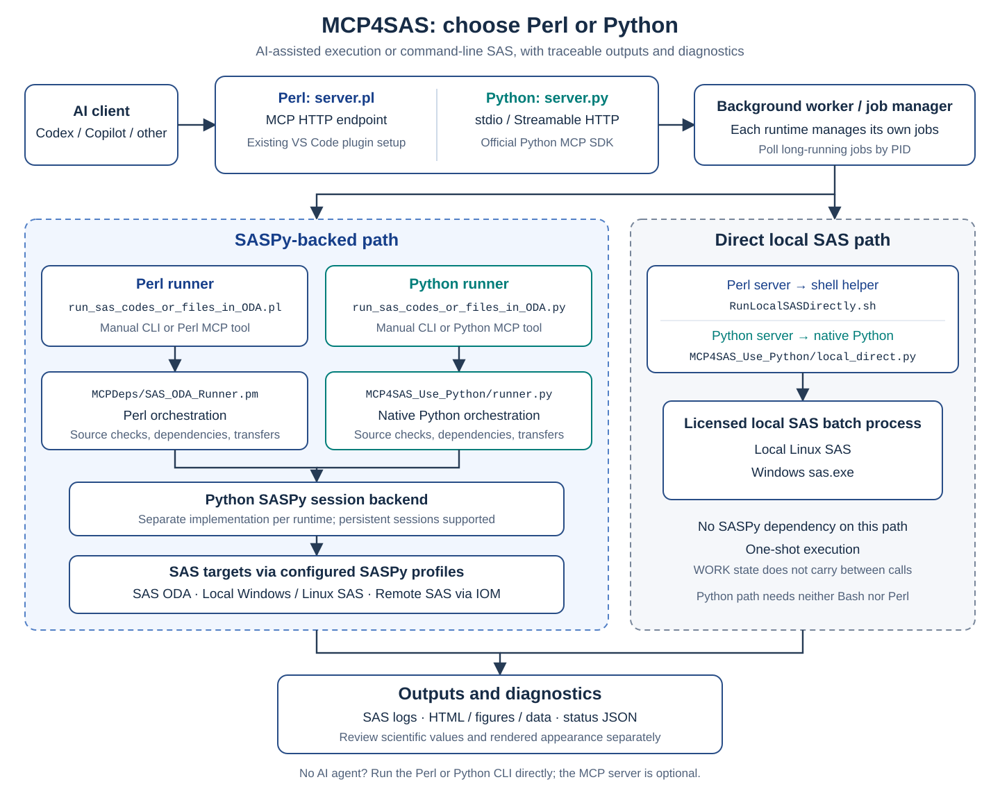

# MCP4SAS execution workflow

[](mcp4sas-workflow.svg)

Choose one server/runtime pair. `server.pl` uses the Perl runners and its existing
HTTP interface. `server.py` uses the independent Python implementation and the
official Python MCP SDK over stdio or loopback Streamable HTTP. The existing
VS Code extension keeps its Perl configuration; the optional Python connection
is described in the [Python setup guide](../../MCP4SAS_Use_Python/README.md).

For SASPy-backed execution, `run_sas_codes_or_files_in_ODA.pl` and its `.py`
counterpart inspect sources, discover local macros/files, manage transfers and
collect SAS results. Each runtime uses its own Python SASPy backend and can reuse
a named session. Targets depend on the installed SASPy profile and the available
SAS license/account. Windows and SAS ODA were exercised live for the Python port;
macOS/Ubuntu CI validates the runtime without a live SAS account.

For direct local execution, the Perl server uses `RunLocalSASDirectly.sh`; the
Python server uses `MCP4SAS_Use_Python/local_direct.py`. This path needs a licensed
local SAS executable and starts a fresh batch process for each submission. It
does not use SASPy or preserve WORK tables between calls.

Without an AI agent, call either CLI runner directly. For example, after the
Python environment has been installed and activated:

```bash
python run_sas_codes_or_files_in_ODA.py --file test.sas
python examples/poc/run_example.py --case clustergram
```

The diagram is an editable, self-contained SVG with selectable text. It has no
external images, scripts or fonts; the repository stores the source used on the
homepage rather than relying on an attachment URL.
