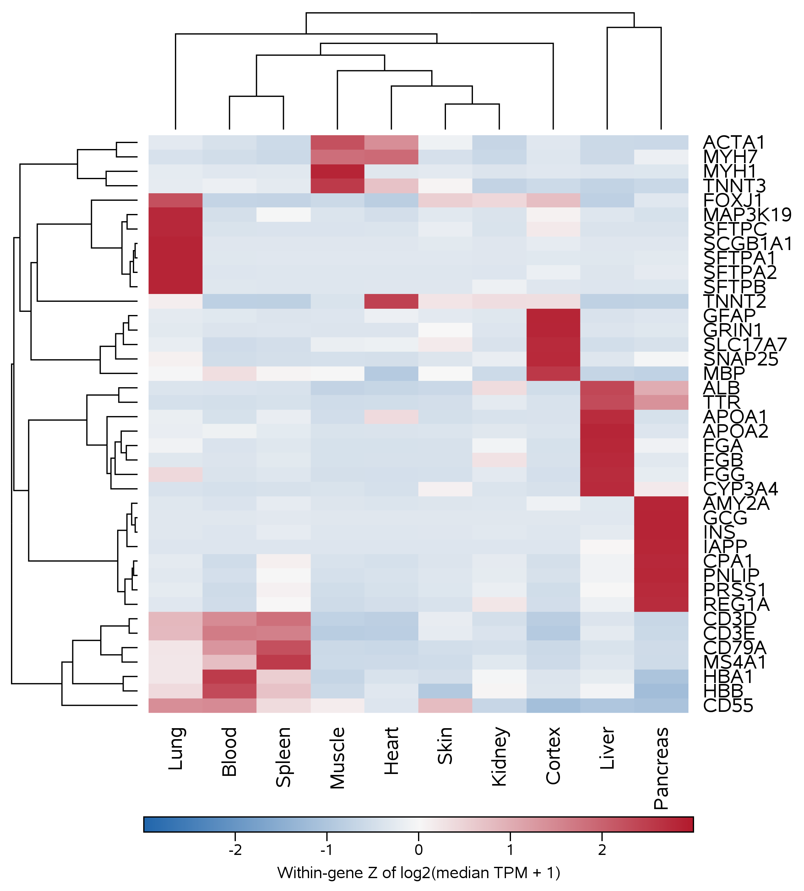
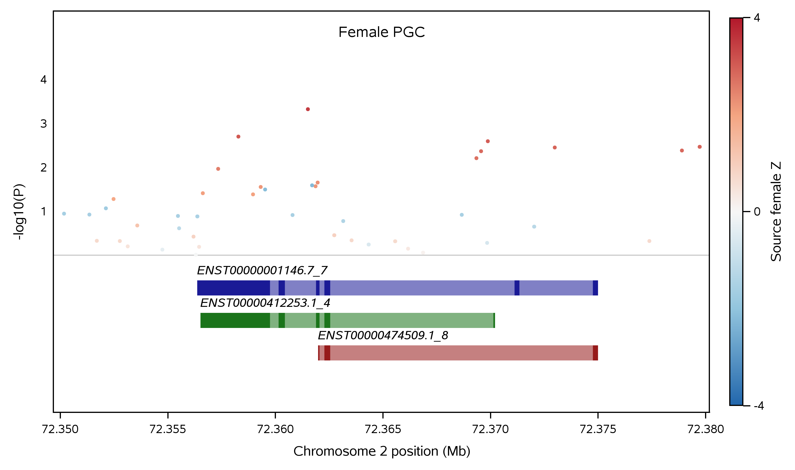
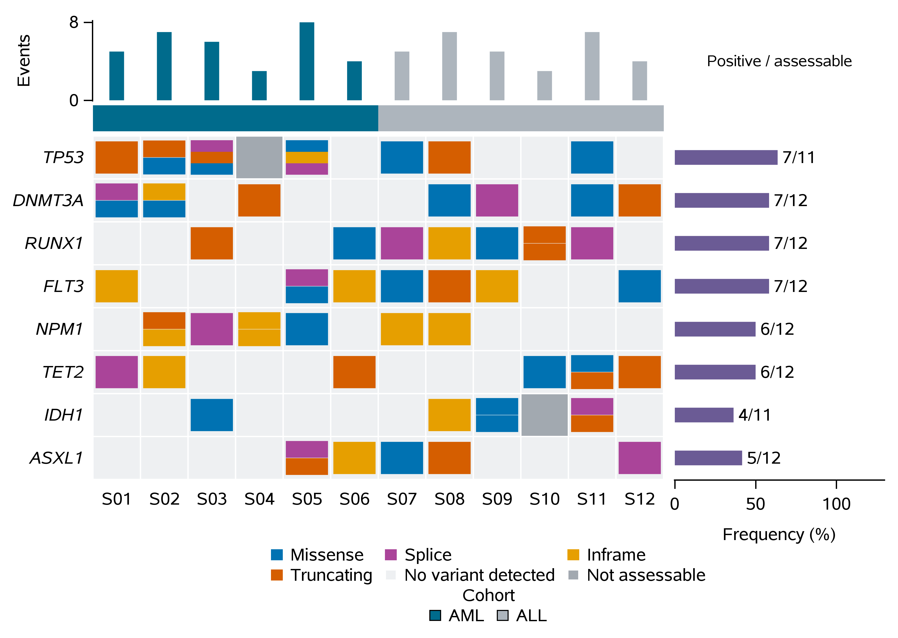
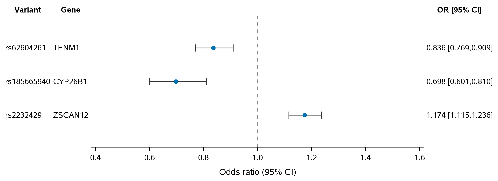
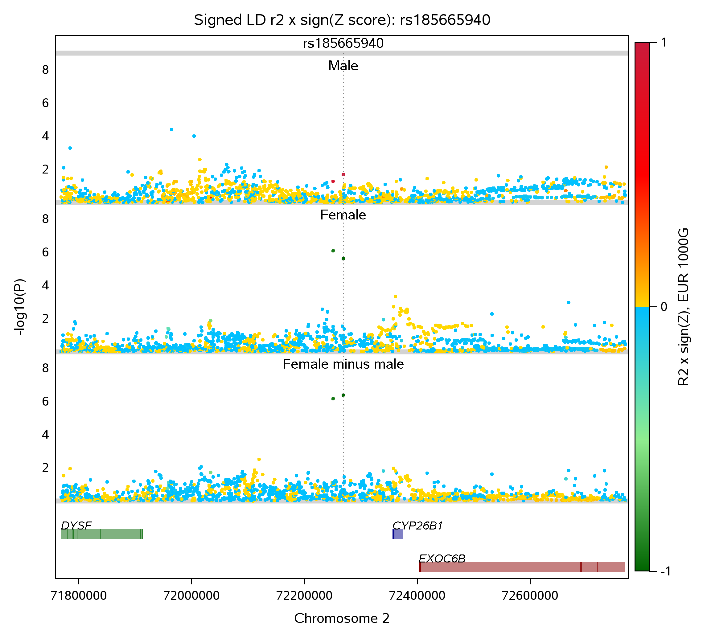

# Scientific proof of concept and runnable showcases

These demonstrations show an AI assistant reusing established SAS programs,
staging their inputs, submitting jobs and collecting checked results through
MCP4SAS. SAS and the supplied macros perform the calculations. The same programs
can also run through a direct SASPy client.

The author's **scientifically edited** documents are the source for this
showcase. The Word files are preserved byte for byte; the reader versions below
retain their scientific wording, tables and embedded figures.

| Document | Read on GitHub | Original Word download |
| --- | --- | --- |
| Proof of concept | [Read the PoC](proof-of-concept.md) | [DOCX](MCP4SAS_Proof_of_Concept_Scientifically_Edited.docx?raw=1) |
| Five scientific use cases | [Read the appendix](use-case-appendix.md) | [DOCX](MCP4SAS_Use_Case_Appendix_Scientifically_Edited.docx?raw=1) |

## Choose an example

Start with `hello` to check the connection and learn where the log and returned
files are saved. The five scientific cases use small prepared inputs and frozen
macro definitions. They are execution demonstrations, rather than complete
genomics research pipelines.

| Case | Input and output | Evidence label |
| --- | --- | --- |
| `hello` | SASHELP.CLASS → PRINT output and a 19-row CSV | SAS teaching dataset |
| `clustergram` | 40 gene profiles × 10 tissues → expression clustergram and branch review | Prepared GTEx v8 tissue-median summaries |
| `gene_gtf` | 43 associations and 3 transcripts → regional association/transcript plot | Selected PGC summaries; GRCh37 annotation |
| `oncoprint` | 64 event records, 8 genes and 12 samples → categorical mutation plot | **Synthetic** events and group assignments; 94 assessable pairs |
| `forest` | 6 estimates → female and male odds-ratio plots | Selected estimates; approximate SE reconstructed from rounded limits |
| `multi_gwas_gtf` | 1,880 variants × 3 panels and 996 annotation records → aligned regional GWAS/gene plot | Prepared PGC summaries; GRCh37; 10 variants retain missing LD |

The scientific programs and required inputs are in
[examples/poc](../../examples/poc/README.md). Their original macro definitions
are included in the saved SAS programs, so they can be executed without pasting
the macro library into a chat. Source and input hashes are in the
[manifest](../../examples/poc/manifest.json).

## Run from a terminal

Install MCP4SAS and configure your SAS target using the
[main setup guide](../../README.md#quick-start). The retained scientific
comparisons used SAS OnDemand for Academics with SAS 9.4 M8. Other compatible
SAS targets require their own execution checks.

From the MCP4SAS repository directory:

```bash
perl run_sas_codes_or_files_in_ODA.pl --check-saspy-connection-only
perl examples/poc/run_example.pl --list
perl examples/poc/run_example.pl --case hello
perl examples/poc/run_example.pl --case oncoprint
perl examples/poc/run_example.pl --case multi_gwas_gtf
```

The helper uploads each case's listed inputs, submits its saved SAS program,
reads the actual SAS log, collects the listed PNG/SVG/CSV files and runs the
numerical checker. Results go into a new `SAS_Output_PoC_*` directory. The
`submit/` directory retains the SAS log, `collect/` retains transfer diagnostics,
`files/` contains downloaded results and `run.json` records the case and warnings.

The default persistent session is `poc_showcase`. Run the examples sequentially;
use `--session-id another_name` for a separate session. Inputs with the packaged
`poc261112_*` basenames are staged in SAS HOME. Generated figures and numerical
tables are collected from that session's WORK directory.

Use `--dry-run` to inspect the submission plan without connecting or uploading:

```bash
perl examples/poc/run_example.pl --case gene_gtf --dry-run
```

The Perl route needs no AI agent or new model request. It reuses the configured
SASPy/Java/SAS backend and saved programs.

## Ask an AI agent

With MCP4SAS connected in Codex, Copilot or another MCP client, give the agent
the repository location and a request such as:

> Run the supplied MCP4SAS oncoprint example using the configured SAS ODA
> connection. Read `examples/poc/manifest.json`, upload the listed input, and
> execute `examples/poc/programs/oncoprint.sas` through MCP4SAS. Reuse one named
> session while collecting the listed outputs from the POC_OUT path in the SAS
> log. Keep warnings visible, run the supplied output checker, and show me the
> figure and log paths. Explain that its 64 events are synthetic and distinguish
> an unassessable pair from a pair with no observed variant.

See [PROMPTS.md](../../examples/poc/PROMPTS.md) for requests covering all six
cases. These prompts execute supplied programs. They are not completed trials
of autonomous code authoring, debugging or token/cost savings.

## Figures from the edited appendix

### Gene-expression clustergram



Colors describe relative expression within each gene across tissues. They do
not compare absolute expression levels between genes.

### Regional association and transcripts



The prepared records and three transcript models share GRCh37 coordinates.
Physical proximity does not establish a causal gene.

### Mutation oncoprint



The 64 synthetic event records occupy an 8 × 12 grid. Prevalence counts unique
mutated assessable pairs; it does not count event records as distinct patients.

### Forest plot



The saved program produces female and male panels. Its reconstructed SE values
depend on rounded confidence limits. Comparing point estimates is not a formal
sex-interaction test.

### Three aligned GWAS panels



From top to bottom: male, female and female-minus-male. The original macro
reverses the requested call order. Ten missing LD values stay missing in the
numerical output, while the figure uses the original display fallback.

## What the comparisons establish

The retained four-case comparison passed 72 checks, including numerical tables
and seven identical decoded PNG arrays. The additional three-panel regional
comparison passed 19 checks. These are saved-program comparisons using the same
programs and inputs, not independent validation of every biological conclusion.

The optimized four-example workflow took 149.49 seconds through MCP4SAS versus
164.27 seconds in the retained direct-SASPy baseline. Those single observations
occurred at different times with archive versus individual file transfers.
They do not establish a general speed advantage. Model tokens, billed cost and
human effort remain unmeasured. The edited PoC gives the per-submission times.

The retained runs included eight warnings for clustergram, eight for the
regional transcript case, two for oncoprint and zero for forest on each route.
Review the actual log when reusing a case. The supplied checker validates files
and selected numerical properties; examine figure appearance and scientific
interpretation separately.

See [PROVENANCE.md](../../examples/poc/PROVENANCE.md) for source versions and the
distinction between retained evidence and new package checks.
