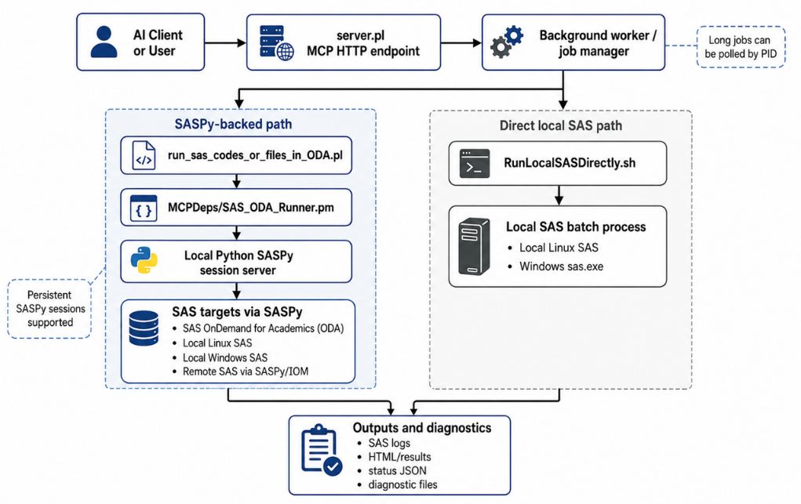

# MCP4SAS: proof of concept

Reader transcription of the [author-supplied Word document](MCP4SAS_Proof_of_Concept_Scientifically_Edited.docx). Scientific wording, tables and embedded figures are retained. See the [showcase guide](README.md) for runnable examples and evidence scope.

AI-assisted SAS execution and reusable genomic visualization workflows

Zhongshan Cheng  |  Evaluation date 12 November 2026

## Objective

Evaluate whether MCP4SAS provides a practical agent-facing interface to existing SAS analyses without changing their numerical results or scientific figures. The comparison uses identical SAS programs and inputs executed through (1) a direct SASPy client and (2) MCP4SAS. The distinctive use case is reuse of established genomic-analysis macros through an AI assistant, not a claim that MCP4SAS performs statistical methods unavailable through SASPy.

## Deployment and execution model

MCP4SAS exposes SAS execution and file operations as Model Context Protocol (MCP) tools. A VS Code extension provides guided setup for Codex or GitHub Copilot; the underlying connection still requires a configured SAS target and private authentication. On Windows the installer can assist with Cygwin and Java prerequisites; macOS and Linux have separate installation routes. For the ODA tests reported here, SASPy connected to SAS 9.4 M8. The client, MCP service, SASPy bridge and SAS session have distinct responsibilities.

## Features relevant to scientific workflows

An agent can discover the MCP tools, submit an existing SAS program, poll an asynchronous job, inspect the SAS log and returned files, and revise a failed submission. Supported local input files and referenced macro sources may be staged for remote execution; persistent SASPy sessions can retain WORK datasets between submissions. These are orchestration capabilities. SAS itself performs the computation, and the programmer remains responsible for verifying inputs, parameter choices and interpretation.

The most valuable demonstration is a user-maintained macro library. The supplied examples call established interfaces for expression clustergrams (%clustergram4sas), local association plots with transcript tracks (%SNP_Local_Manhattan_With_GTF), mutation oncoprints (%MGXOncoPrint) and forest plots (%Beta2OR_forest_plot). MCP4SAS allows an assistant to invoke such workflows without independently generating their plotting logic. The macros are neither trained into the model nor scientifically validated merely because the run completes.

| Capability | Direct SASPy client | MCP4SAS tool interface |
| --- | --- | --- |
| Connect an AI client | Requires application-specific agent integration | Discoverable MCP tools; VS Code setup guidance |
| Run SAS and move files | SASPy methods called by client code | Tools wrap SAS execution and supported file operations |
| Use existing SAS macros | Caller loads macro files and builds invocation | Agent can request supported macro/file staging and execution |
| Handle long jobs and errors | Caller implements polling and log retrieval | Job IDs, status polling and returned diagnostics |
| Revise an analysis | Custom agent-to-SAS integration required | Agent can inspect results and submit corrected SAS |

The direct SASPy baseline can run the same programs and load the same macros. The comparison therefore measures interface and workflow differences, not new statistical functionality.

## Observed results and limitations

Four retained example programs were run against SAS OnDemand for Academics using SASPy 5.104.0 and SAS 9.4 M8. The direct client used SASPy session, upload, submit, download and shutdown methods; MCP4SAS submitted the same program bytes and inputs through its tool interface. The table reports recorded submission durations in seconds. Smaller values indicate faster completion of the measured submission, not a more accurate analysis.

| Program / figure | Direct SASPy (s) | MCP4SAS (s) |
| --- | --- | --- |
| Clustergram | 9.37 | 13.68 |
| Regional gene/transcript plot | 6.27 | 21.17 |
| Mutation oncoprint | 2.42 | 5.13 |
| Forest plot | 4.94 | 18.11 |

In the supplied comparison, exported numerical tables agreed in row order and values within a relative tolerance of 1 × 10⁻¹⁰; seven paired PNG outputs had identical decoded pixels. The recorded checks covered 40-gene expression scaling, 43 local association data points with three transcript tracks, oncoprint event/callability summaries and reconstructed forest-plot effects. These checks establish equivalence of the tested outputs, not independent biological validity.

For the four-example workflow, the retained optimized MCP4SAS run took 149.49 s versus 164.27 s for the direct baseline. These single observations were collected at different times and used different file-transfer patterns (archive batching versus individual transfers). They cannot establish a general speed advantage.

The appendix provides 5 scientific demonstrations. Four have paired direct-SASPy/MCP4SAS output comparisons; a fifth has a recorded multi-GWAS rendering comparison.
