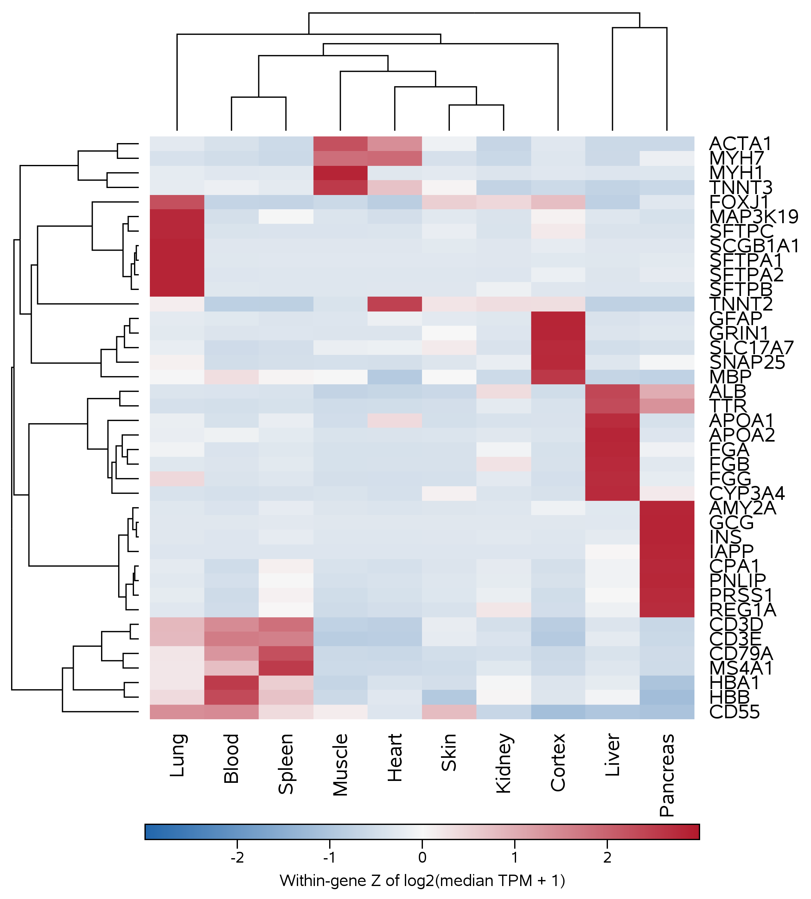
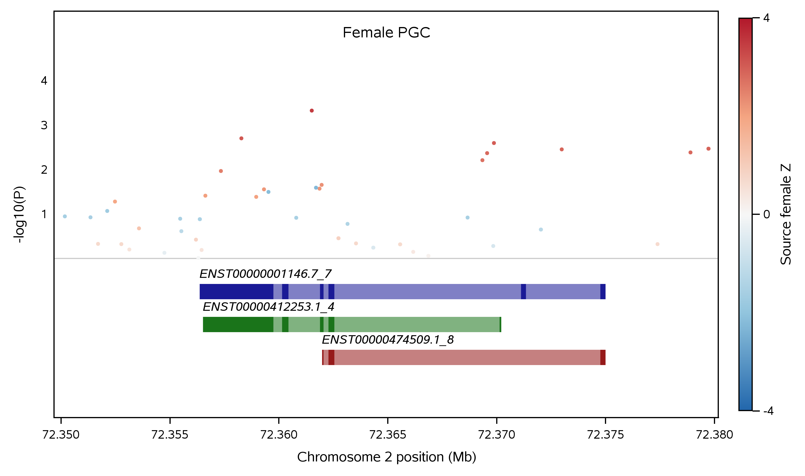
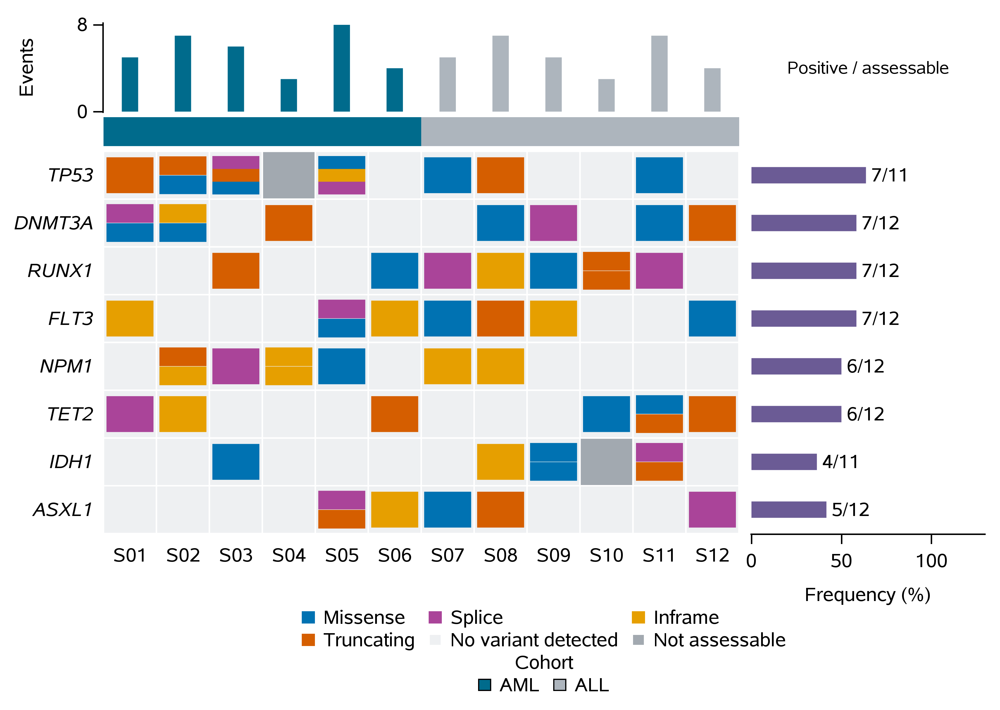
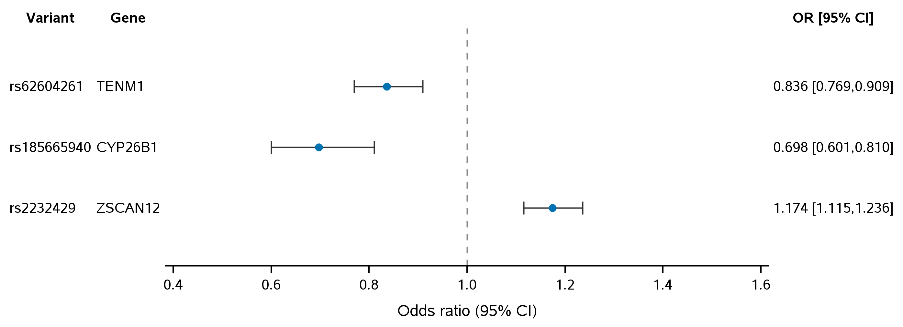
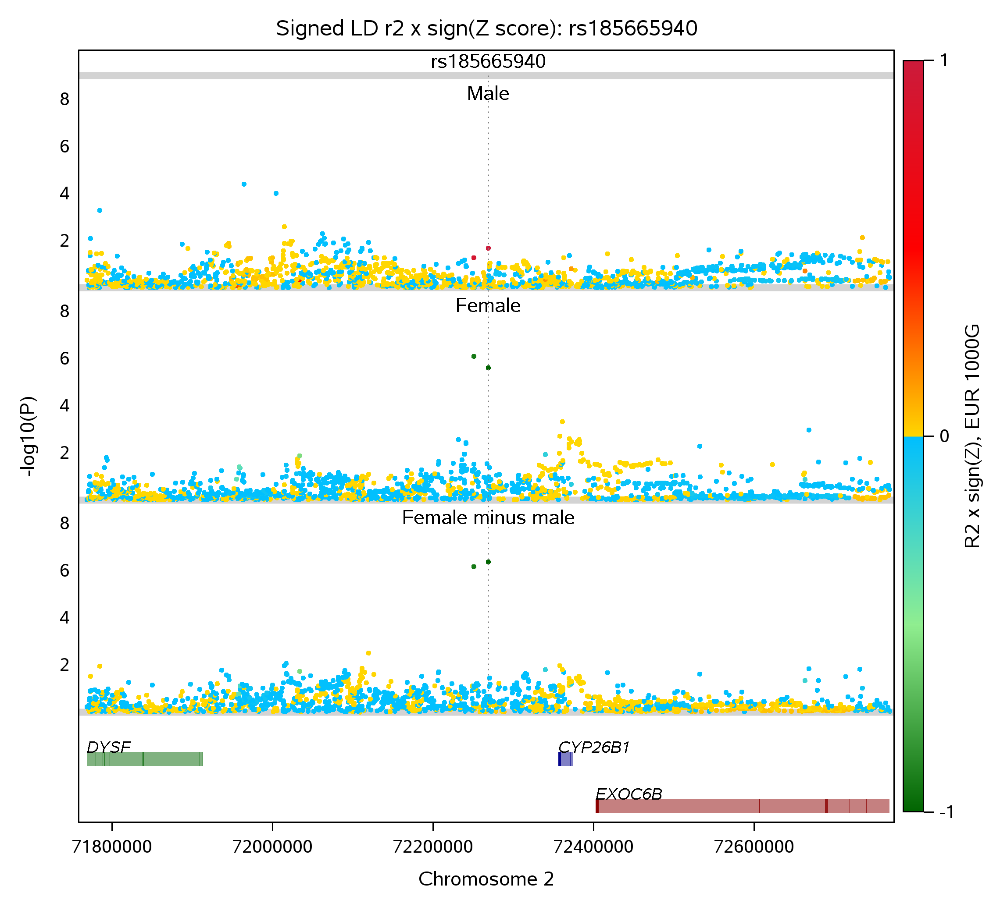

# MCP4SAS scientific use case appendix

Reader transcription of the [author-supplied Word document](MCP4SAS_Use_Case_Appendix_Scientifically_Edited.docx). Scientific wording, tables and embedded figures are retained. See the [showcase guide](README.md) for runnable examples and evidence scope.

## Use case 1 | Gene-expression clustergram

Question: how do expression patterns differ across ten tissues for a selected panel of 40 genes? The input consists of GTEx v8 tissue-median expression profiles, not individual donors. The retained SAS program applies log₂(TPM + 1), then standardizes values within each gene before clustering. The resulting colors represent relative, within-gene expression across tissues; they must not be read as absolute expression differences between genes.

### SAS macro and reproducible input

The supplied [programs/clustergram.sas](../../examples/poc/programs/clustergram.sas) calls %clustergram4sas and %review_tree_branches to render the standardized matrix and its clustering structure. Run the existing SAS program on the configured ODA target using MCP4SAS or direct SASPy; retain the log, numerical matrix, tree outputs and PNG/SVG figures. This is a plotting demonstration using fixed input summaries, not a new expression analysis.

The analysis uses %clustergram4sas for clustering/plotting and %review_tree_branches for the retained branch display. No macro parameter values should be inferred from this abbreviated description; the SAS source is authoritative.



Figure A1. SAS clustergram of 40 tissue-median gene profiles after log transformation and within-gene standardization. The compared direct-SASPy and MCP4SAS PNGs were pixel-identical in the supplied test.

### Interpretation and validation

A red cell indicates a relatively high transformed expression value for that gene across the ten tissues; blue indicates relatively low expression. The dendrogram represents similarity under the clustering settings in the supplied program, not a causal or clinical relationship. The recorded checks covered 40 gene rows, ten values per gene, the transformed matrix and both tree tables. Changing output dimensions should not change the matrix values.

Recorded submission times: direct SASPy 9.37 s; MCP4SAS trial 11, 13.68 s. Eight warnings were retained in each route. Because warning text is not analyzed in this appendix, their presence must not be described as warning-free execution. Consult the supplied SAS logs before reusing this workflow.

## Use case 2 | Regional association and transcript tracks

Question: which association signals and annotated transcripts occupy a defined region near CYP26B1? The retained input includes 43 prepared female PGC association records and three selected transcripts, mapped to GRCh37 chromosome 2 (72,350,000–72,380,000 bp). This demonstration renders those selected data; it does not rerun an association study or establish a causal gene.

### SAS macro and reproducible input

The supplied [programs/gene_gtf.sas](../../examples/poc/programs/gene_gtf.sas) invokes %SNP_Local_Manhattan_With_GTF with transcript-focused display options. Both execution routes use the same prepared association and GTF-derived records. Inspect the saved program, execution log, numerical plotting table and rendered figure to confirm that P values and gene coordinates were not changed.

Key source interface: %SNP_Local_Manhattan_With_GTF with focus_on_transcript=1. See the source code for all required data and parameter names.



Figure A2. Local association points over three selected transcript models at the specified GRCh37 locus. The compared PNG outputs were pixel-identical in the supplied test.

### Interpretation and validation

Association height is −log₁₀(P); higher points correspond to smaller P values. Transcript bars indicate genomic annotations, not functional proof that CYP26B1 mediates the signal. The documented checks cover the assembly, chromosome interval, 43 association records, three transcript identifiers and the columns passed to the plotting macro. A gene’s physical proximity alone does not establish causality.

Recorded submission times: direct SASPy 6.27 s; MCP4SAS trial 11, 21.17 s. Eight warnings were retained in each route. Review those log entries before using the figure in a scientific report.

## Use case 3 | Mutation oncoprint

Question: how can mutation categories, sample groups and the distinction between assessed and unassessed gene–sample pairs be shown together? This example uses synthetic data: 64 event records for eight genes and twelve samples. The 96 possible gene–sample pairs include two marked unassessable, leaving 94 assessable opportunities. Neither the events nor the clinical group assignments describe a real cohort.

### SAS macro and reproducible input

The supplied [programs/oncoprint.sas](../../examples/poc/programs/oncoprint.sas) calls %MGXOncoPrint to combine event classes, sample/group annotation, per-sample burden and per-gene frequency. Compare the figure with the categorical event and callability tables, because an absent color may mean either no observed variant or no assessment.

Original plotting macro: %MGXOncoPrint. The supplied caller specifies the sample, gene, event and callability inputs.



Figure A3. Synthetic oncoprint with distinct mutation classes and an explicit not-assessable state. The compared PNG outputs were pixel-identical in the supplied test.

### Interpretation and validation

The grid has 8 × 12 = 96 pairs, of which 94 are assessable. The 64 input event records must not be interpreted as 64 distinct mutated samples or gene–sample pairs: a pair can contain more than one event. For a gene, the prevalence numerator counts samples with at least one qualifying event and the denominator counts assessable samples for that gene. The retained checks cover both quantities.

Recorded submission times: direct SASPy 2.42 s; MCP4SAS trial 11, 5.13 s. Two warnings were retained in each route. These are synthetic counts and do not estimate patient mutation prevalence.

## Use case 4 | Forest plot of association estimates

Question: how can selected sex-stratified association estimates be compared without confusing overlap in confidence intervals with a formal interaction test? The input comprises six selected PGC estimates. The plotting program reconstructs log-odds effects and approximate standard errors from stored odds ratios and rounded confidence limits; rounding affects the reconstructed Wald statistics.

### SAS macro and reproducible input

The supplied [programs/forest.sas](../../examples/poc/programs/forest.sas) uses %Beta2OR_forest_plot and a retained display caller to place the effect estimates and intervals alongside their numerical labels. The figure reproduces selected reported estimates; it is not a new meta-analysis.

Original macro: %Beta2OR_forest_plot, with the documented display caller. Effect-size inputs and label order are defined in the SAS program.



Figure A4. Selected odds ratios and 95% confidence intervals. The dashed reference is OR = 1; compared PNGs were pixel-identical in the supplied test.

### Interpretation and validation

The reconstruction uses β = ln(OR) and SE ≈ [ln(upper CI) − ln(lower CI)] / 3.92, assuming a conventional two-sided 95% Wald interval on the log-odds scale. Check the effect scale, variant order, confidence endpoints and OR = 1 reference. Differences between male and female point estimates do not, by themselves, prove a sex interaction; that requires a direct test of the contrast.

Recorded submission times: direct SASPy 4.94 s; MCP4SAS trial 11, 18.11 s. Both routes retained zero warnings for this program. Numerical comparisons in this use case are conditional on the rounded published inputs.

## Use case 5 | Three-panel regional GWAS and gene annotation

### Scientific question and agent request

Using the supplied PGC schizophrenia summary data, display the female-minus-male contrast, female GWAS and male GWAS across a window around rs185665940. Align their genomic coordinates, plot −log₁₀(P) for each analysis, color points using the supplied signed LD statistic, and add GRCh37 gene/exon annotations with the original SAS macro. Execute the saved program and report the final plotting output and SAS log.

### Data, macro and panel ordering

The retained input has 1,880 variant rows and 996 GRCh37 annotation records. Each association P-value column must be paired with the corresponding signed-statistic column; changing their order independently would mislabel the scientific results. The native macro renders the first requested analysis at the bottom, so the displayed order is the reverse of the call order. At the index variant rs185665940, the supplied P values and signed statistics are:

| Analysis | P value | Signed statistic |
| --- | --- | --- |
| Female minus male | 4.321342e-7 | -5.054228 |
| Female | 2.45e-6 | -4.714600 |
| Male | 0.02057 | 2.315926 |

This excerpt comes from [programs/multi_gwas_gtf.sas](../../examples/poc/programs/multi_gwas_gtf.sas). The complete program supplies the macro definitions, data, graphics destinations and numerical exports.

```sas
%SNP_Local_Manhattan_With_GTF(gwas_dsd=work.region,
 chr_var=CHR,AssocPVars=EUR_DIFF_P EUR_FEMALE_P EUR_MALE_P,
 ZscoreVars=EUR_STD_Z EUR_FEMALE_Z EUR_MALE_Z,
 gwas_labels_in_order=Female_minus_male Female Male,
 SNP_IDs=rs185665940,SNP_Var=SNP,Pos_Var=BP,
 gtf_dsd=work.gtf,dist2snp=500000,makedotheatmap=1,
 LD_display_mode=heatmap,LD_r2_var=LD_R2,
 LD_reference_snp=rs185665940,
 SNPs2label_scatterplot_dots=rs185665940,text_rotate_angle=0,
 label_headroom_frac=0.03,label_center_offset=0.65);
```

### Observed execution and interpretation

The retained comparison reports 19 passing numerical/rendering checks, including 5,640 plotted association rows (1,880 variants × 3 panels) and pixel-identical direct/MCP PNG outputs. Submission times were 66.45 s by direct SASPy and 89.14 s through optimized MCP4SAS. These are saved-program runs, not independent evidence that a language-model agent can repair a scientific plot; model time and token cost remain unmeasured.

For rs185665940, the female-minus-male P value is 4.321342 × 10⁻⁷, above the conventional genome-wide significance cutoff of 5 × 10⁻⁸. Directional statistics retain the supplied contrast orientation. Gene proximity in the annotation panel does not identify a causal gene without additional evidence.

## Figure A5 | Three aligned GWAS panels with gene tracks



Figure A5. Actual SAS output from the MCP4SAS route. From top to bottom, the original macro displays male, female and female-minus-male panels (1,880 variants each). The gene track uses GRCh37. Ten variants have missing LD estimates; the display applies the original fallback color while the stored numeric LD values remain missing.

The reference marker and SNP label use the supplied plotting parameters (label_headroom_frac=0.03; label_center_offset=0.65). These control layout, not association P values or coordinates. The generated GTL template is retained as multi_gwas_template.sas.
